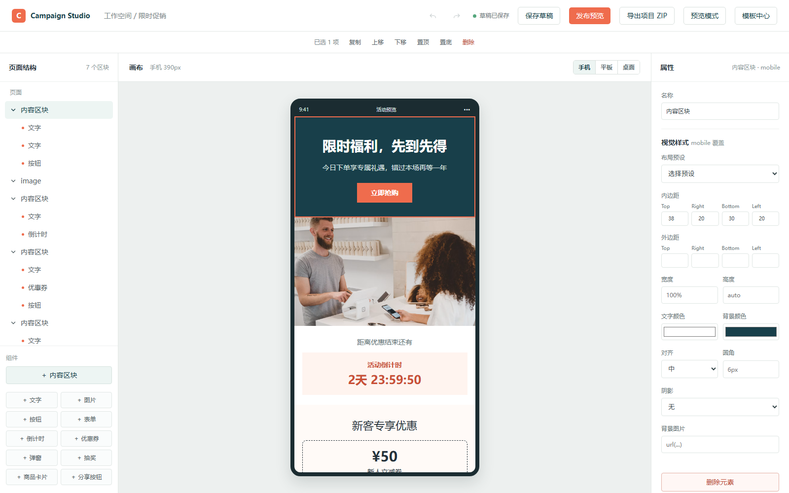
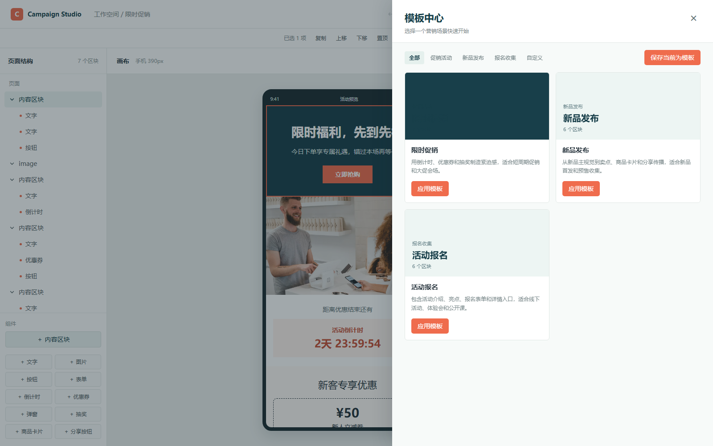

# Campaign Studio

面向活动页搭建场景的低代码平台。基于内置模板和营销组件拖拽即可完成活动页编排，Schema、预览和导出能力由本仓库统一维护。

页面以结构化组件树（`PageSchema`）保存，编辑、预览、导出全部在浏览器内完成，不依赖后端服务。当前定位为公司内部 MVP，适合限时促销、新品发布、活动报名这类 H5 营销页。



## 功能




- **模板中心**：内置限时促销、新品发布、报名收集模板，支持把当前页面保存为自定义模板
- **组件编排**：12 种节点类型，从「内容区块 → 营销组件」两级结构拖拽搭建
- **编辑能力**：同级拖拽排序、虚影占位、多选、复制删除、撤销重做、组件级样式覆盖
- **响应式预览**：手机、平板、桌面三档画布尺寸，每个节点可单独配置三端样式
- **发布交付**：预览模式、发布预览、导出独立 HTML、导出可直接上传的 ZIP 包
- **导出检查**：导出前跑一遍 Schema 与资源校验，生成 `QA-CHECKLIST.md` 和 `manifest.json`

## 技术栈

Vue 3、TypeScript、Pinia、Vite 6，pnpm workspace 单仓多包。

## 快速开始

需要 Node.js 18+ 和 pnpm 10+。

```bash
pnpm install
pnpm dev          # 编辑器 http://localhost:5173
pnpm dev:runtime  # 活动页运行时 http://localhost:5180
```

其他命令：

```bash
pnpm typecheck    # 全仓库 TypeScript 和 Vue 类型检查
pnpm build        # 构建控制台和活动页运行时
```

> pnpm 10 默认不执行依赖的安装脚本。仓库已在 `pnpm-workspace.yaml` 中用 `onlyBuiltDependencies` 放行 `esbuild` 和 `vue-demi`，否则 esbuild 不会生成原生二进制，vite 会启动失败。

## 目录结构

```text
apps/
  console/                    编辑器控制台
    src/App.vue               编辑器整体布局与全局快捷键
    src/components/editor/    画布、图层树、属性面板、模板中心、组件面板
    src/stores/editor.ts      编辑器状态、草稿、撤销重做、模板应用
    src/exportPage.ts         HTML、ZIP、资源打包与产物生成
    src/exportValidation.ts   导出前校验规则
    src/preview.ts            预览模式与发布预览渲染
    src/templates.ts          内置模板定义
  page-runtime/               独立活动页运行时，读取已发布 Schema 渲染
packages/
  schema/                     PageSchema、节点类型、校验、迁移、树操作工具
  components/                 营销组件注册表与组件实现
  component-runtime/          组件定义类型与 createRegistry
```

## 使用流程

1. 打开编辑器，默认加载模板中心第一个模板
2. 选择场景模板，或把当前页面保存为自定义模板
3. 从组件面板新增内容，在右侧属性面板配置文案、图片、样式和事件
4. 切换手机、平板、桌面检查响应式效果
5. 用「预览模式」查看浏览态页面，「发布预览」查看发布版本
6. 导出项目 ZIP，按报告处理 `FAIL` 和 `WARN` 项后上传静态服务器

## 编辑器快捷键

| 快捷键 | 作用 |
| --- | --- |
| `Ctrl/Cmd + S` | 保存当前草稿到本地 |
| `Ctrl/Cmd + D` | 复制选中组件（输入框内不触发） |

## 组件与 Schema

页面是一棵树，根节点类型固定为 `page`，营销内容放在 `section` 里，组件通过 `children` 嵌套。

节点类型：

| 类型 | 说明 |
| --- | --- |
| `page` | 页面根节点，承载页面标题 |
| `section` | 内容区块，控制背景和内边距 |
| `text` | 文字，支持 `h1` 和段落 |
| `image` | 图片，要求填写 `alt` |
| `button` | 行动按钮，可绑定事件 |
| `form` | 表单，配置字段列表后渲染输入框 |
| `countdown` | 倒计时，按 `endAt` 实时刷新 |
| `coupon` | 优惠券卡片，金额加使用说明 |
| `lottery` | 抽奖按钮，配置奖品列表 |
| `modal` | 弹窗触发器 |
| `product` | 商品卡片，图片加名称价格 |
| `share` | 分享按钮 |

一个节点的结构如下：

```ts
interface NodeSchema {
  id: string
  type: NodeType
  version: string
  props: Record<string, unknown>
  styles: Record<string, string>
  responsiveStyles?: Partial<Record<'mobile' | 'tablet' | 'desktop', Record<string, string>>>
  events: EventConfig[]
  children?: NodeSchema[]
}
```

事件支持 `click`、`submit`、`load`，每个事件挂一组动作：`open-url` 打开链接、`show-toast` 弹提示、`open-modal` 打开弹窗、`track` 打埋点。动作只会序列化进导出的 Schema，由运行时解释执行。

新增内置模板时复用 `packages/schema` 的 `createNode` 和 `NodeType`，修改 Schema 结构时同步更新 `migrateSchema` 和 `validateExport`。

## 活动页运行时

编辑完成的 Schema 由 `apps/page-runtime` 渲染，与编辑器共用 `packages/components` 的组件实现，样式和交互保持一致。


## 导出产物

「导出项目 ZIP」生成的结构：

```text
活动名称-v1-时间戳/
  index.html                 带 og 分享标签的入口页
  assets/
    styles.css
    runtime.js               内联的运行时渲染逻辑
    images/                  编辑器上传的图片
  README.md
  QA-CHECKLIST.md            自动检查结果 + 上传后人工验收项
  manifest.json              版本、导出时间、本地图片数、preflight 状态
```

`manifest.json` 中的 `preflight.status` 在存在 `error` 级问题时为 `blocked`，否则为 `passed`；`warnings` 数组记录远程图片、空文案这类不阻塞发布的问题。上传时保持 `index.html` 与 `assets/` 同级，远程图片沿用原 URL。

## 本地数据

编辑器数据全部存在浏览器 `localStorage`，不同项目之间不互通，换浏览器需要重新导入。

| Key | 内容 |
| --- | --- |
| `campaign-editor-draft` | 当前草稿 Schema |
| `campaign-editor-templates` | 自定义模板列表 |
| `campaign-editor-current-template` | 当前使用的模板名 |
| `campaign-page-schema` | 已发布的 Schema，供 page-runtime 读取 |
| `campaign-editor-export-versions` | 各项目的导出次数，用于生成 `v1`、`v2` |
